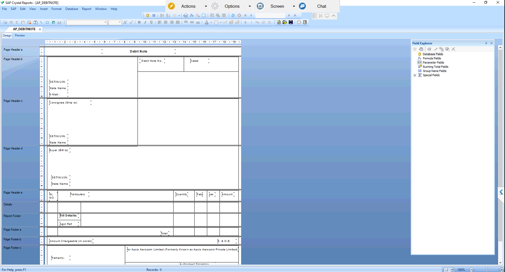

# AP Debit Note – Crystal Report

## Overview
Custom Crystal Report for SAP Business One that prints the Debit Note raised to a supplier, built on the A/P Credit Memo document.
Shows supplier and ship-to details with GSTIN and state, item lines, CGST/SGST/IGST amounts, rounding, total, amount in words and remarks.

## Purpose of this Report
Gives a GST-compliant document to send to suppliers for returns, rejections or price corrections.
Supports the purchase team and accounts in settling the adjusted amount against the original supplier bill.

## Result
Designed with the data query, then validated with sample documents and approved by the client.
After approval it was moved to live and is now used for supplier debit notes.
