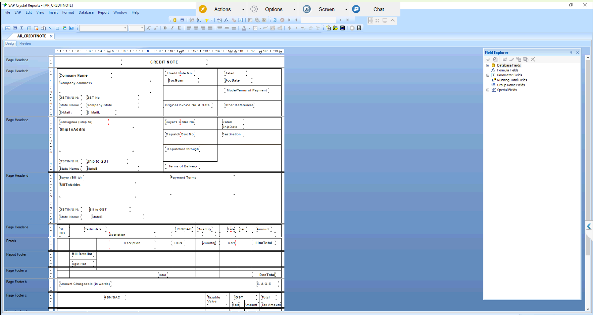

# AR Credit Note – Crystal Report

## Overview
Custom Crystal Report for SAP Business One that prints the Credit Note issued to a customer, built on the A/R Credit Memo document.
Shows company and customer details with GSTIN and state, original invoice reference, item lines by HSN, GST breakup, total and amount in words.

## Purpose of this Report
Gives customers a proper tax document when an invoice is reduced for returns, rejections or rate corrections.
Helps accounts reverse sales and GST correctly and keeps the credit traceable to the original invoice.

## Result
Designed with the data query, then validated with sample documents and approved by the client.
After approval it was moved to live and is now used for customer credit notes.
