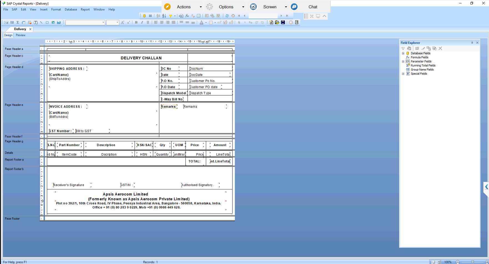

# Delivery Challan – Crystal Report

## Overview
Custom Crystal Report for SAP Business One that prints the Delivery Challan from the Delivery document.
Shows shipping and invoice addresses, DC number and date, customer PO number and date, dispatch type, e-way bill details, item lines with HSN, quantity, UOM and price, and a total.

## Purpose of this Report
Gives a formal document to travel with the goods when they leave the plant, recording what was delivered against which customer PO.
Also serves as the reference for the later sales invoice and for receiver acknowledgement.

## Result
Designed with the data query, then validated with sample deliveries and approved by the client.
After approval it was moved to live and is now used for daily dispatches.
