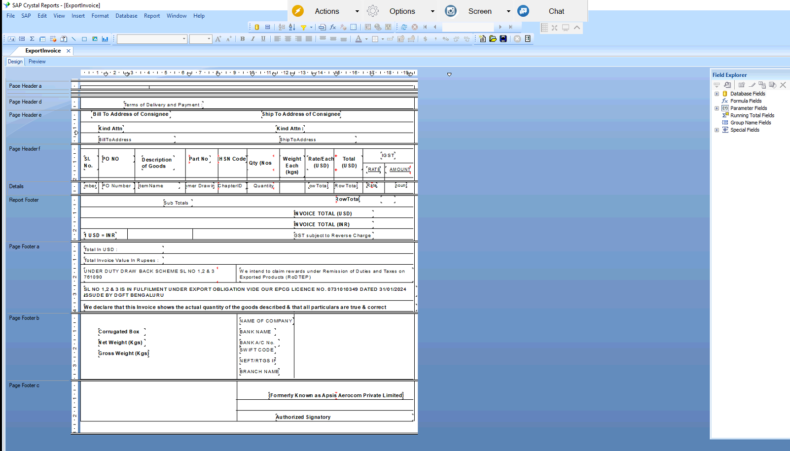

# Export Invoice – Crystal Report

## Overview
Custom Crystal Report for SAP Business One that prints the Export Invoice from the A/R Invoice document.
Shows bill-to and consignee addresses, PO and delivery challan references, HSN, quantity, weights, USD and INR values, IGST, bank details and export declarations.

## Purpose of this Report
Gives overseas customers and customs a single invoice with both foreign-currency and rupee totals, and links each line to its PO and delivery challan.
Also carries the export scheme statements needed for shipping and duty benefits.

## Result
Designed with the data query, then validated with sample export invoices and approved by the client.
After approval it was moved to live and is now used for export billing.
