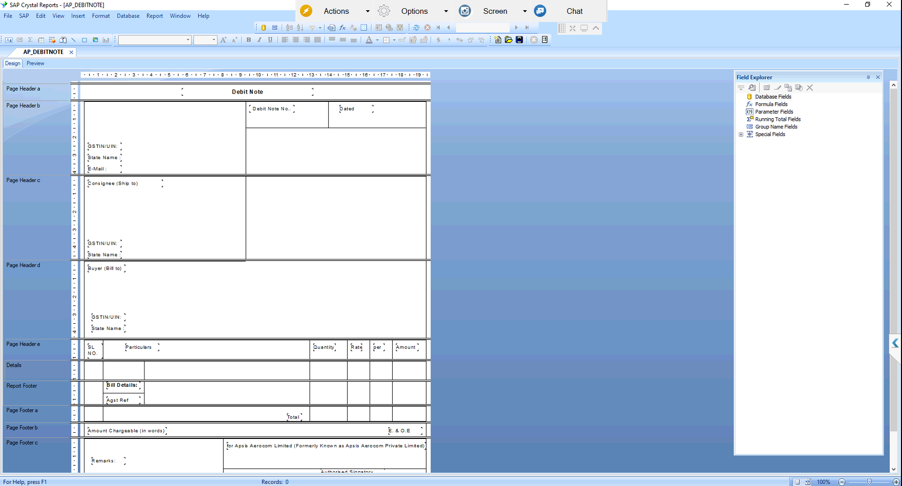

# AP Debit Note (Crystal Report)

## Overview
Debit Note layout built in SAP Crystal Reports on SAP Business One purchase return and correction data. It shows supplier, consignee and buyer details with GSTIN, item lines, CGST, SGST and IGST, total and amount in words.

## Purpose of this Report
Gives a formal, GST-ready document to send to suppliers for returns or price corrections. It keeps the reason, tax and amount on one signed page.

## Result
After validation and approval from the client, the report was moved into the live environment.

Query: [APDebitNoteQuery.txt](APDebitNoteQuery.txt)
