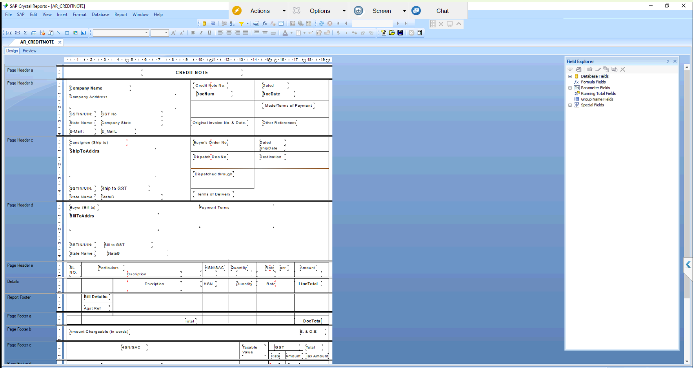

# AR Credit Note (Crystal Report)

## Overview
Credit Note layout built in SAP Crystal Reports on SAP Business One A/R Credit Memo data. It shows company, consignee and buyer details with GSTIN, original invoice reference, item lines and a HSN-wise tax summary.

## Purpose of this Report
Gives customers a formal credit document for returns or price corrections. It shows the taxable value and the CGST, SGST or IGST reversed.

## Result
After validation and approval from the client, the report was moved into the live environment.

Query: [ARCreditNoteQuery.txt](ARCreditNoteQuery.txt)
