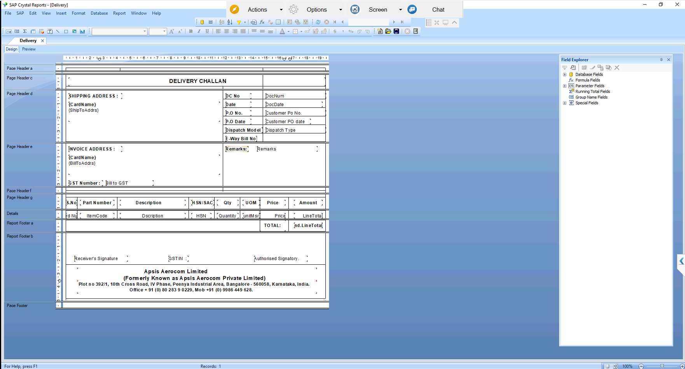

# Delivery Challan (Crystal Report)

## Overview
Delivery Challan built in SAP Crystal Reports on SAP Business One Delivery data. It shows shipping and invoice addresses, DC number and date, customer PO number and date, dispatch type, item lines with HSN, quantity, price and total.

## Purpose of this Report
Gives a printable document that travels with the goods at dispatch. It links each delivery to the customer PO and carries GST and e-way bill details.

## Result
After validation and approval from the client, the report was moved into the live environment.

Query: [DeliveryQuery.txt](DeliveryQuery.txt)
