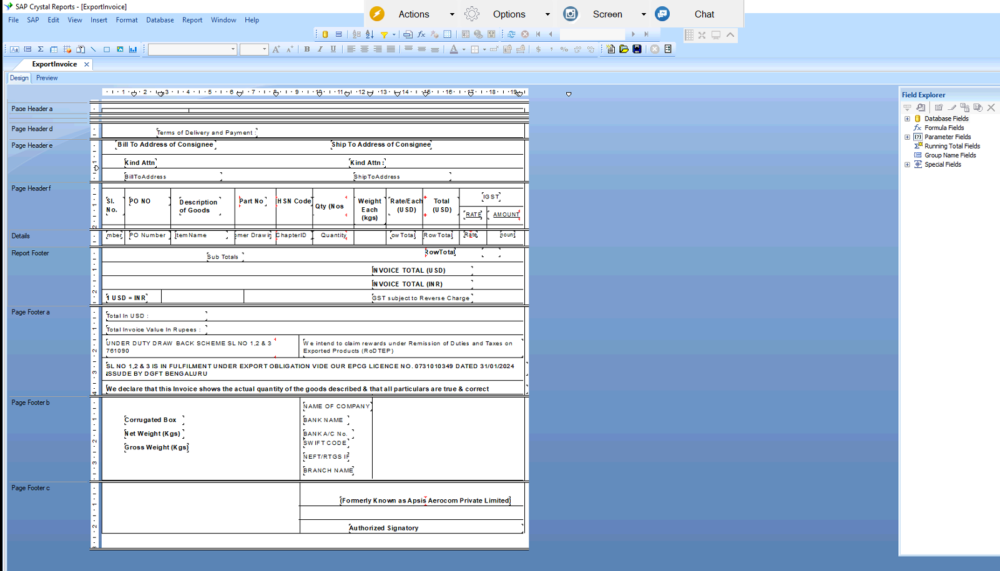

# Export Invoice (Crystal Report)

## Overview
Export Invoice built in SAP Crystal Reports on SAP Business One A/R Invoice data. It shows amounts in USD with INR conversion, PO and DC references, HSN codes, IGST, weights and bank details.

## Purpose of this Report
Gives an export-ready invoice for customs and customers, including duty drawback and RoDTEP declarations. It replaces manual invoice preparation for shipments.

## Result
After validation and approval from the client, the report was moved into the live environment.

Query: [ExportInvoiceQuery.txt](ExportInvoiceQuery.txt)
