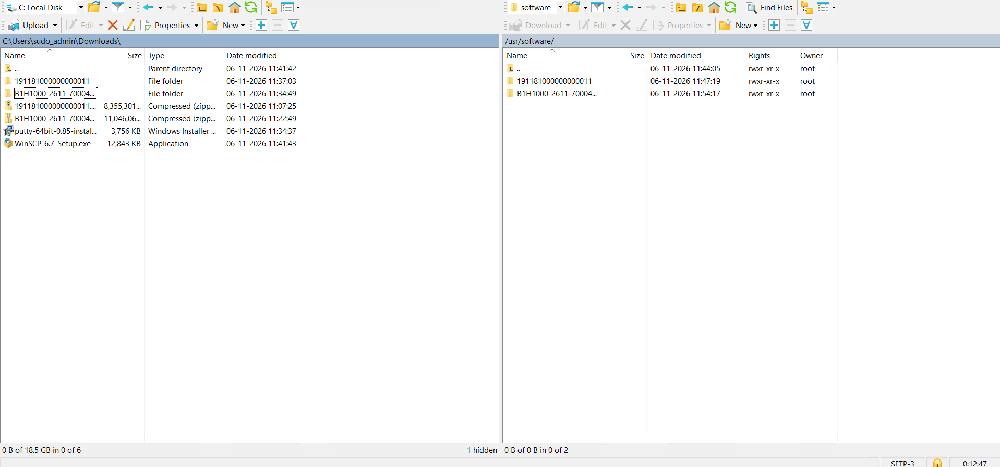

# SAP Business One Installation on SUSE Linux

## Overview
Installed SAP Business One server components on SUSE Linux (SAP HANA platform) using packages from SAP Software Center.
Files were transferred from a Windows laptop to the Linux server with WinSCP and installed from the command line.

## What was installed
- SAP HANA package (folder `191181000000000011`)
- SAP Business One for HANA package (folder `B1H1000_2611-70004...`)
- Tools used: WinSCP (file transfer) and PuTTY (SSH terminal)

## Steps
1. **Download:** Get the SAP HANA and SAP Business One packages from SAP Software Center.
2. **Upload:** Copy the zip files from `C:\Users\<user>\Downloads` to `/usr/software/` on the server using WinSCP (SFTP).
3. **Extract:** Unzip both packages on the server, so each has its own folder under `/usr/software/`.
4. **Install:** Log in with PuTTY as root and run the installer from each extracted folder.
5. **Verify:** Check that services are running and that the SAP Business One client can connect.

## Screenshot
WinSCP session: Windows Downloads (left) and `/usr/software/` on the SUSE server (right).

## Prerequisites checked
- Supported SUSE Linux version, with enough disk space and memory
- Hostname and DNS resolve correctly
- Required ports open between client, server and database
- Root access and SFTP access to the server

## Result
SAP software staged and extracted on the SUSE server in an organised folder structure, ready for installation.
