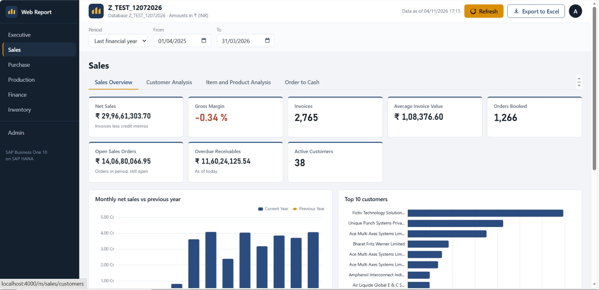
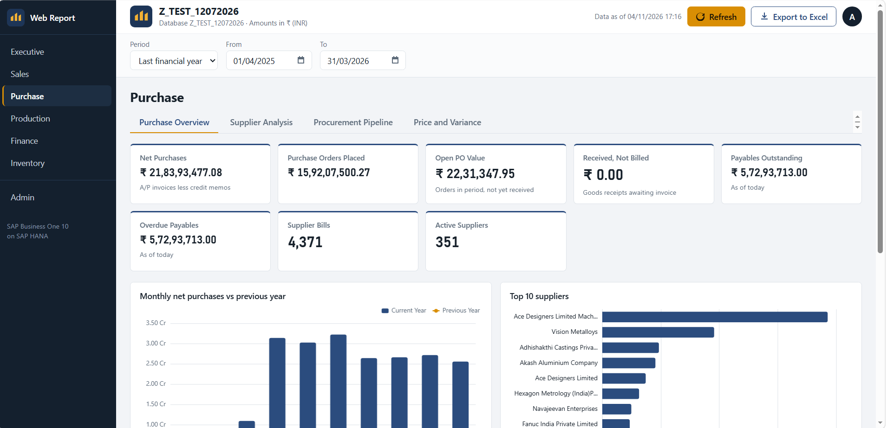
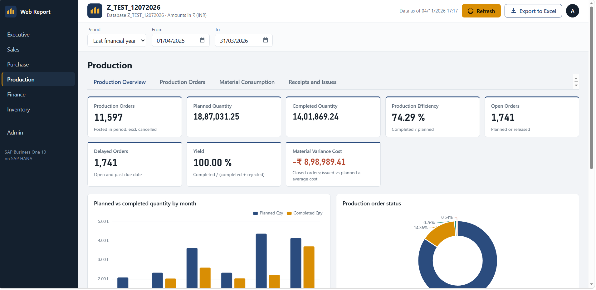
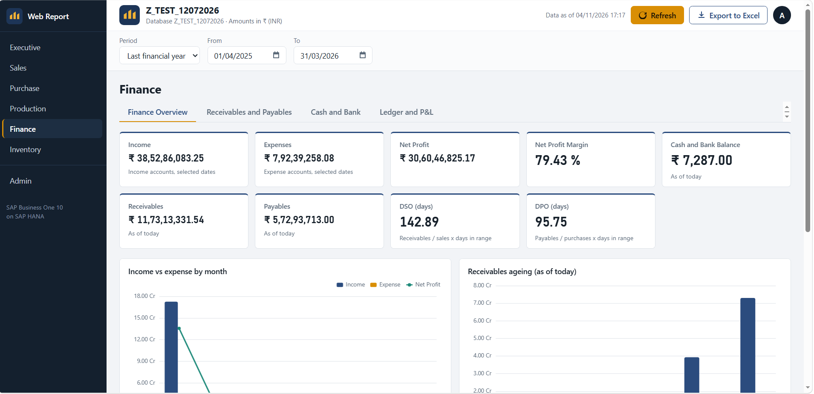
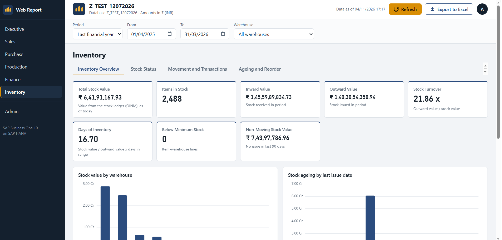
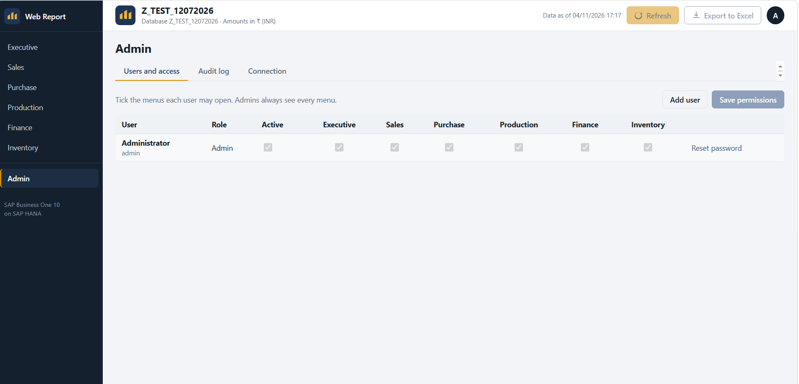

# SAP Business One Web Report

## Overview
Designed and built a web-based reporting dashboard on SAP Business One 10 (SAP HANA) that shows live KPIs and charts in the browser.
Includes date and warehouse filters, year-on-year comparison, Excel export and role-based access, as a lightweight alternative to Power BI.

## Need for this Web Report
Managers needed quick, reliable business numbers without manual Excel work or paid per-user BI licences.
This solution gives one browser-based view of SAP data, so decisions are made on current figures.

## 6 Web Reports: Business Perspectives

**1. Sales** – Tracks net sales, gross margin, open orders, overdue receivables and top 10 customers.
Helps the sales team see revenue trends and the order-to-cash cycle.

**2. Purchase** – Monitors net purchases, open POs, received-not-billed value, payables and top 10 suppliers.
Helps control procurement spend and supplier dues.

**3. Production** – Shows planned vs completed quantity, efficiency, delayed orders, yield and material variance.
Helps the shop floor spot delays and cost overruns early.

**4. Finance** – Reports income, expenses, net profit, cash and bank balance, receivables ageing, DSO and DPO.
Helps management track profitability and cash position.

**5. Inventory** – Covers stock value, turnover, days of inventory, below-minimum and non-moving stock by warehouse.
Helps reduce excess stock and avoid stock-outs.

**6. Admin** – Manages users, password resets, menu-level access by role, audit log and connection settings.
Helps keep sensitive data visible only to the right people.

## Result
Replaced manual reporting with a single live dashboard across five business functions, with secure role-based access.
Delivered at no per-user BI licence cost, needing only a web browser.

*Screenshots use test data.*
